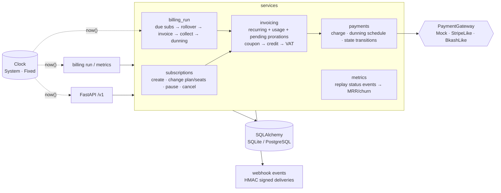

<!-- topics: fastapi,python,saas,billing,subscriptions,invoicing,proration,dunning,sqlalchemy,alembic,mrr -->
# saas-subscription-billing

A recurring billing engine for SaaS products: plans with seats and metered add-ons, trials, coupons, mid-cycle changes with exact proration, period invoicing with VAT, card dunning, signed webhooks and MRR/churn metrics, all driven by an injectable clock so any month can be billed and replayed deterministically.

[](https://github.com/AkibUllah/saas-subscription-billing/actions/workflows/ci.yml)


## Try it live

| | |
|---|---|
| API reference | https://akibullah.github.io/saas-subscription-billing/ — Swagger UI built from the exported OpenAPI document (static; no backend behind it) |
| Run in your browser | [](https://codespaces.new/AkibUllah/saas-subscription-billing?quickstart=1) — starts API + scheduler + PostgreSQL with `docker compose`, runs `billing seed` (plans, coupons, five customers) and one `billing run`; open forwarded port 8000 at `/docs` with `X-API-Key: change-me`. |
| One-click deploy | [](https://render.com/deploy?repo=https://github.com/AkibUllah/saas-subscription-billing) — `render.yaml` provisions the web service and a free PostgreSQL; the container migrates and seeds on start, `API_KEY` is generated (read it from the service's environment tab). |
| Local | `docker compose up` (see Quick Start) |

## Why this exists

Every SaaS product I have helped ship eventually hit the same wall: the first "billing" is a cron job that charges a card once a month, and it falls apart the moment a customer adds three seats on the 17th, asks for a refund of the unused half, or has a card that bounces for a week. Stripe Billing solves this for USD merchants; teams billing in BDT through bKash agreements or a local card acquirer mostly do not have that option and end up re-inventing proration in a spreadsheet. This repository is the engine I would want underneath such a product: integer money, a real subscription state machine, invoices built from line items so every paisa is explainable, and a billing run that can be re-executed for the same instant without double-charging anyone.

## Features

- Customers, plans (monthly / yearly, flat + per-seat with included seats, metered add-ons with included units), coupons (percent / fixed; once / repeating / forever; redemption caps) and trials
- Subscription lifecycle `TRIALING → ACTIVE → PAST_DUE → (CANCELED | UNPAID)` plus pause/resume, enforced by an explicit transition table; every change is recorded as a status event
- Mid-cycle plan upgrades/downgrades and seat changes prorated on exact elapsed seconds; prorations accumulate as pending lines for the next invoice or are invoiced immediately (`invoice_now`); interval changes (monthly → yearly) reset the billing anchor
- Period invoices with plan, seat, usage, proration, coupon, customer-credit and VAT (15% BD default) lines; yearly invoice numbering (`INV-2026-000042`); JSON and HTML (Jinja2) renderings
- `PaymentGateway` protocol with a deterministic `MockGateway` (behaviour chosen by card token) and clearly labelled `StripeLikeGateway` / `BkashLikeGateway` stubs
- Dunning: retries 1, 3, 5 and 7 days after issue, then the invoice is written off and the subscription becomes `UNPAID`; a successful retry or manual payment reactivates it
- Idempotent billing run (`POST /v1/billing/run?as_of=` or `billing run --as-of`) that rolls subscriptions over, catches up missed periods, collects payments and processes dunning
- Outgoing webhooks for every customer/subscription/invoice event, HMAC-SHA256 signed (`X-Billing-Signature: t=…,v1=…`), stored before delivery with per-delivery attempt history
- Metrics endpoint: MRR, ARR (net of active coupons, yearly plans normalised), churn, trial conversion, invoiced and collected totals for any window and any `as_of`
- Alembic migrations, SQLite for dev/tests, PostgreSQL via docker compose, admin API key, structured error envelope

## Architecture



Design notes:

- **Money is integers.** Every amount is in minor units (paisa). Percentages and prorations are computed as exact `Fraction`s and rounded half-up once, so a credit and a charge for the same remaining window never disagree by a paisa.
- **Time is injected.** Services take `now`; the API and CLI read it from a `Clock`. Tests and `scripts/simulate.py` use a `FixedClock` to walk through months in milliseconds, and the billing run accepts an `as_of` so a missed night can be replayed.
- **Idempotency comes from state.** A subscription is due while `current_period_end <= as_of`; the rollover advances the period in the same transaction that creates the invoice. The unique `invoices.period_key` (`<subscription>:<period_start>`) is the backstop if two runs ever race.
- **Invoices are built from lines.** Recurring lines for the period starting, usage lines for the period that ended, pending proration lines, then coupon, customer credit and VAT. Nothing on an invoice is a derived number without a line behind it.
- **Lifecycle is a table, not ifs.** `core.states.TRANSITIONS` is the single source of truth; the API turns an `InvalidTransition` into a `409`.
- **Dunning is relative to issue date,** not to the previous attempt, so catching up on a late run does not compress the schedule.

## Tech Stack

| Layer | Choice |
| --- | --- |
| API | FastAPI, Pydantic v2, Jinja2 invoice rendering |
| Persistence | SQLAlchemy 2.0 ORM, Alembic; SQLite (dev/tests), PostgreSQL 16 (compose, psycopg 3) |
| CLI | Typer (`billing run`, `billing metrics`, `billing seed`) |
| Payments | `PaymentGateway` protocol; mock + labelled stubs over httpx |
| Config | pydantic-settings / `.env` |
| Tooling | pytest + coverage, ruff, Makefile, GitHub Actions (3.10/3.11, docker build, simulation smoke run) |

## Quick Start

### Docker Compose (API + hourly billing scheduler + PostgreSQL)

```bash
git clone https://github.com/AkibUllah/saas-subscription-billing.git && cd saas-subscription-billing
cp .env.example .env
docker compose up --build -d          # runs alembic upgrade head before starting the API
curl -s localhost:8000/health
```

### Local (SQLite)

```bash
make install
make dev                               # http://127.0.0.1:8000, docs at /docs
.venv/bin/billing seed                 # demo plans, coupons and five customers
```

Create a plan, a customer and a subscription, then bill a month later:

```bash
export KEY=change-me   # API_KEY from .env (leave empty to disable auth locally)
H=(-H "X-API-Key: $KEY" -H "Content-Type: application/json")

curl -s -X POST localhost:8000/v1/plans "${H[@]}" -d '{
  "code":"team","name":"Team","interval":"month","base_amount_minor":400000,
  "per_seat_amount_minor":80000,"included_seats":3,
  "meters":[{"metric":"sms","unit_amount_minor":50,"included_units":1000}]}'

curl -s -X POST localhost:8000/v1/customers "${H[@]}" \
  -d '{"name":"Dhaka Grocers Ltd","email":"billing@dhakagrocers.example","payment_token":"tok_ok"}'

curl -s -X POST localhost:8000/v1/subscriptions "${H[@]}" \
  -d '{"customer_id":"cus_…","plan_id":"team","seats":5}'          # invoices ৳6,440.00 incl. VAT

curl -s -X POST "localhost:8000/v1/subscriptions/sub_…/seats" "${H[@]}" -d '{"seats":8}'
curl -s -X POST "localhost:8000/v1/billing/run?as_of=2026-02-01T00:00:00Z" "${H[@]}"
curl -s "localhost:8000/v1/metrics?window_days=30" "${H[@]}"
```

### Simulation

`python scripts/simulate.py` bills five customers for three months in memory with a fixed clock: a 14-day trial that converts and later upgrades, a team account that adds seats mid-cycle and sends SMS over its quota, a yearly plan with a 20% launch coupon, a card that declines through the whole dunning schedule, and a cancel-at-period-end. Real output:

```
Simulation: 5 customers, 01 Jan 2026 → 31 Mar 2026, daily billing runs

Month     Active Trial  New Churn  Churn %           MRR            ARR     Invoiced    Collected
-------------------------------------------------------------------------------------------------
Jan 2026       4     0    5     1    20.0%    ৳11,933.33    ৳143,199.96   ৳50,715.00   ৳46,115.00
Feb 2026       4     0    0     0     0.0%    ৳16,833.33    ৳201,999.96   ৳13,688.70   ৳13,688.70
Mar 2026       3     0    0     1    25.0%    ৳15,333.33    ৳183,999.96   ৳15,985.00   ৳15,985.00

Trial conversion: 1/1 = 100%

Subscriptions
  Chattogram Logistics   Team               seats=8  active    period 01 Mar 2026 → 01 Apr 2026
  Dhaka Grocers Ltd      Team               seats=1  active    period 15 Mar 2026 → 15 Apr 2026
  Khulna Fish Export     Team               seats=3  unpaid    period 01 Jan 2026 → 01 Feb 2026
  Rajshahi AgriTech      Starter            seats=1  canceled  period 01 Feb 2026 → 01 Mar 2026
  Sylhet Tea Traders     Business (yearly)  seats=1  active    period 01 Jan 2026 → 01 Jan 2027

Invoices
  INV-2026-000001  01 Jan  Chattogram Logistics   paid              ৳6,440.00
  INV-2026-000002  01 Jan  Sylhet Tea Traders     paid             ৳36,800.00 discount ৳8,000.00 (LAUNCH20)
  INV-2026-000003  01 Jan  Khulna Fish Export     uncollectible     ৳4,600.00 [card_declined × 5]
  INV-2026-000004  01 Jan  Rajshahi AgriTech      paid              ৳1,150.00 discount ৳500.00 (WELCOME500)
  INV-2026-000005  15 Jan  Dhaka Grocers Ltd      paid              ৳1,725.00
  INV-2026-000006  01 Feb  Rajshahi AgriTech      paid              ৳1,725.00
  INV-2026-000007  01 Feb  Chattogram Logistics   paid              ৳6,900.00
  INV-2026-000008  10 Feb  Dhaka Grocers Ltd      paid                ৳463.70
  INV-2026-000009  15 Feb  Dhaka Grocers Ltd      paid              ৳4,600.00
  INV-2026-000010  01 Mar  Chattogram Logistics   paid             ৳11,385.00
  INV-2026-000011  15 Mar  Dhaka Grocers Ltd      paid              ৳4,600.00
```

Spot checks: INV-000008 is the Starter → Team upgrade on 10 Feb with 5 of 31 days left: ৳1,500 × 5/31 credited, ৳4,000 × 5/31 charged, net ৳403.22 + 15% VAT = ৳463.70. INV-000010 contains the 5→8 seat change made on 15 Feb (3 × ৳800 × 14/28 = ৳1,200) and 1,400 SMS over the included 1,000 at ৳0.50.

## API

All `/v1` routes require `X-API-Key` when `API_KEY` is set. Errors are `{"error": {"code", "message"}}`; invalid lifecycle transitions are `409`.

| Method | Path | Purpose |
| --- | --- | --- |
| `POST` · `GET` | `/v1/customers` · `/v1/customers/{id}` | Create / list / fetch; `PATCH` updates the payment token |
| `POST` · `GET` · `DELETE` | `/v1/plans` · `/v1/plans/{id_or_code}` | Plans with seats, trial and metered add-ons; delete retires |
| `POST` · `GET` | `/v1/coupons` | Percent / fixed, once / repeating / forever, redemption caps |
| `POST` | `/v1/subscriptions` | Subscribe (`seats`, `coupon_code`, `trial_days` override); invoices and charges immediately unless trialing |
| `GET` | `/v1/subscriptions` · `/{id}` | Filter by `customer_id`, `status`; detail includes plan and status history |
| `POST` | `/v1/subscriptions/{id}/change-plan` | `{plan_id, seats?, invoice_now?}` with proration |
| `POST` | `/v1/subscriptions/{id}/seats` | `{seats, invoice_now?}` with proration |
| `POST` | `/v1/subscriptions/{id}/pause` · `/resume` | Freeze billing; resume shifts the period end by the paused time |
| `POST` | `/v1/subscriptions/{id}/cancel` | `{at_period_end: true}` (default) or immediately with optional `credit_unused` |
| `POST` | `/v1/subscriptions/{id}/reactivate` | Revoke a scheduled cancellation |
| `POST` | `/v1/subscriptions/{id}/usage` | Metered usage with `idempotency_key` |
| `GET` | `/v1/invoices` · `/{id_or_number}` · `/{id}/html` | Filter by customer / subscription / status; HTML rendering |
| `POST` | `/v1/invoices/{id}/pay` | Retry collection now (after a card update); reactivates an `UNPAID` subscription |
| `POST` | `/v1/billing/run?as_of=` | Idempotent billing run; `GET /v1/billing/runs` lists past runs |
| `GET` | `/v1/metrics?as_of=&window_days=` | MRR, ARR, churn, trial conversion, invoiced / collected |
| `POST` · `GET` · `DELETE` | `/v1/webhooks/endpoints` | Register receivers (secret shown once) |
| `GET` | `/v1/webhooks/events` | Events with delivery status; `POST /v1/webhooks/dispatch` sends pending |
| `GET` | `/health` | DB check, gateway name, current clock |

Webhook events: `customer.created`, `subscription.created|updated|paused|canceled|unpaid`, `invoice.created|paid|payment_failed|uncollectible`. Verify on the receiving side with `saas_billing.core.signing.verify(secret, body, header, now)`.

Mock gateway tokens: `tok_ok`, `tok_decline`, `tok_insufficient`, `tok_fail_then_ok:<n>`.

## Project Structure

```
saas_billing/
├── main.py                 # app factory: create_app(settings, clock=, gateway=, transport=)
├── cli.py                  # billing run | metrics | seed
├── clock.py                # Clock protocol, SystemClock, FixedClock
├── config.py · database.py · models.py · schemas.py · demo.py
├── core/                   # pure functions, no I/O
│   ├── money.py            # minor units, bps, half-up rounding, ৳ formatting
│   ├── periods.py          # add_months with day clamping, interval maths
│   ├── proration.py        # remaining_fraction, prorate, prorate_change
│   ├── states.py           # lifecycle transition table
│   ├── coupons.py · dunning.py · signing.py · ids.py
├── gateways/               # PaymentGateway protocol, MockGateway, StripeLike/BkashLike stubs
├── services/
│   ├── subscriptions.py    # create, change plan/seats, pause/resume, cancel, usage
│   ├── invoicing.py        # line builders, finalize_invoice, numbering, HTML render
│   ├── payments.py         # collect + dunning
│   ├── billing_run.py      # the idempotent run
│   ├── metrics.py          # MRR/ARR/churn/trial conversion
│   ├── webhooks.py · lifecycle.py · customers.py · plans.py · context.py
├── api/                    # routers per resource
└── templates/invoice.html
alembic/                    # env.py + versions/0001_initial_schema.py
scripts/simulate.py         # the 3-month simulation above
tests/                      # 76 tests, in-memory SQLite, FixedClock, MockGateway, MockTransport
```

## Testing

```bash
make test        # pytest
make cov         # with coverage (93% at the time of writing)
make lint        # ruff check + format check
```

Covered: money rounding and month arithmetic (31 Jan + 1 month, leap years); proration at exact midpoints and the credit/charge pair sharing one fraction; coupon durations across successive invoices (once / repeating / forever, yearly plans); the dunning schedule walked day by day to `UNPAID` and recovery mid-schedule; every valid and invalid lifecycle transition; trial conversion on the billing run; seat and plan changes (pending vs. immediate invoices, trial no-ops, interval reset); pause/resume period shifting; cancel at period end with a final usage invoice; immediate cancel voiding open invoices and crediting unused time; idempotent and catch-up billing runs; invoice numbering per year; VAT and tax exemption; customer credit application; metered usage attribution to the right period; MRR/ARR/churn/trial metrics; the HTTP API including auth, error envelopes, HTML invoices and signed webhook delivery with retries; gateway stubs over `httpx.MockTransport`; and that `alembic upgrade head` produces exactly the model schema.

## Roadmap

- Row-level locking (`SELECT … FOR UPDATE SKIP LOCKED`) so several billing workers can share one PostgreSQL queue
- Per-customer tax profiles (VAT registration number, reverse charge) instead of one global rate
- Refunds as first-class objects with gateway calls, instead of credit-balance adjustments only
- Scheduled pauses/resumes and scheduled plan changes at period end
- PDF invoices (the HTML template is print-ready; wiring WeasyPrint is the remaining step)

## License

MIT — see [LICENSE](LICENSE).
